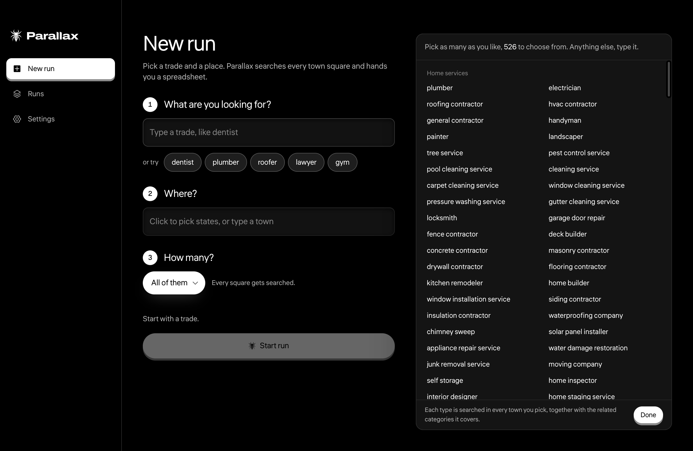
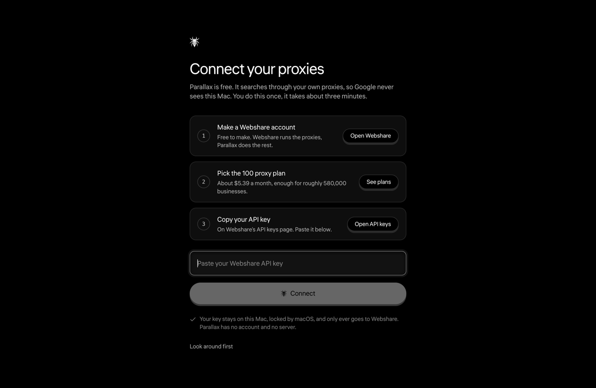
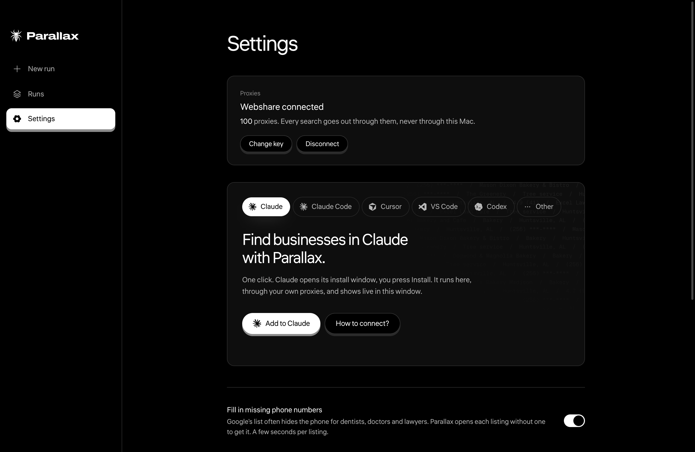

<p align="center">
  
</p>

<h1 align="center">Parallax</h1>

<p align="center">Every business on Google Maps, in a spreadsheet. Free, on your own Mac.<br><a href="https://parallaxleads.com">parallaxleads.com</a></p>

<p align="center">
  <a href="https://github.com/matixacik-cell/parallax-releases/releases/latest/download/Parallax.dmg"></a>
  
  
  
  <a href="https://parallaxleads.com"></a>
</p>

<p align="center">
  
</p>

## What it does

Pick a trade and a place. Parallax searches Google Maps town by town and writes every business it finds into a spreadsheet. A town is a handful of searches. A whole state is a few hundred, and the map shows them light up while they run.

**What you get, per business:** name, category, phone, website, address, rating, number of reviews, opening hours, open or closed status, town, region, country, the search term that found it, coordinates, the Google Maps link and the place id. One row each, and no repeats across runs while skipping is on.

**How it searches:**

- Every town GeoNames lists with 5,000 or more people is on the map (69,174 of them, worldwide). Each town gets a square sized by its population; big cities are cut into many squares so nothing is missed.
- A trade also searches its related categories. "Plumber" searches plumbing service, drain cleaning service and water heater installer too, and each of those is its own search in every square. There are 526 business types to pick from, or type your own. The New run screen shows the real count before you start.
- Listings that hide the phone number (dentists, doctors, lawyers do this a lot) are opened one by one to get it.
- Businesses you already have from an earlier run are skipped, so every run brings new ones. You can turn that off.
- You set the cap: a number of businesses, a time limit, or everything.

**How fast, roughly:** one search takes about 20 seconds and brings about 30 businesses. Two to five searches run at once, picked from your Mac's memory (three on a 16 GB Mac). One town and one search word is done in a minute. A whole state and one search word is about 400 searches: around 45 minutes on a 16 GB Mac and about 5 GB of proxy data.

## Requirements

- A Mac with Apple silicon (M1 or newer), macOS 12 or newer. Intel Macs are not covered by this build yet.
- Google Chrome installed. Parallax drives a hidden copy of it for the searches.
- A Webshare account for the proxies (below).

## Download

1. Download [Parallax.dmg](https://github.com/matixacik-cell/parallax-releases/releases/latest/download/Parallax.dmg), open it, drag Parallax into Applications.
2. First open: macOS says it cannot verify the app, because we do not have an Apple developer certificate yet. Right click Parallax in Applications, choose Open, then Open again. On macOS 15 or newer there is no Open button: double click Parallax, let macOS refuse it, then open System Settings, Privacy and Security, scroll down and click Open Anyway.
3. The app walks you through connecting your proxies. Three steps, about three minutes. Look around first skips it; Settings, Connect proxies brings it back.

## Your own proxies

Parallax searches through proxies you own, so Google never sees your Mac. Make a Webshare account. On its pricing page, under Proxy Server, pick 100 proxies, set the country to United States and switch on High IP Reputation. That comes to about $5.39 a month with 250 GB of data, enough for roughly 580,000 businesses. Then paste your API key into the app once. The key stays on your Mac, locked by macOS, and only ever goes to Webshare.

The free 10 proxy plan connects but is not enough: its 1 GB is about 170 searches, and ten addresses get blocked fast. You need the 100 proxy plan.

Your API key is on Webshare's dashboard, under API keys. The Open API keys button in the app takes you there. If the app says Webshare did not accept the key, open that page again and copy the whole key. If it says the account has no proxies yet, the plan has not been bought or has not started yet.

<p align="center">
  
</p>

## Use it from your AI tools

<p align="center">
  <picture><source media="(prefers-color-scheme: dark)" srcset="assets/logos/claude-white.svg"></picture>&nbsp;&nbsp;&nbsp;&nbsp;&nbsp;
  <picture><source media="(prefers-color-scheme: dark)" srcset="assets/logos/cursor-white.svg"></picture>&nbsp;&nbsp;&nbsp;&nbsp;&nbsp;
  <picture><source media="(prefers-color-scheme: dark)" srcset="assets/logos/vscode-white.svg"></picture>&nbsp;&nbsp;&nbsp;&nbsp;&nbsp;
  <picture><source media="(prefers-color-scheme: dark)" srcset="assets/logos/codex-white.svg"></picture>
</p>

Parallax has a connector for Claude, Claude Code, Cursor, VS Code and Codex. Open Settings in the app, pick your tool, press one button.

<p align="center">
  
</p>

Then ask:

```text
Find 20 roofers in Sedona with phone numbers.
```

The run shows live in the Parallax window and the rows come back into the chat. A small search comes back finished in one call; a big one reports progress until it ends.

Under the hood this is an MCP server (the standard way AI tools plug in). It runs on your Mac only and talks to the app through a local door on your Mac. The tools it gives your assistant:

| Tool | What it does |
| --- | --- |
| `parallax_preview` | What a search would cover: the towns, the business types, and the approximate searches, businesses, minutes and data. Instant, costs nothing. |
| `parallax_start` | Start a search. With a wait of up to 50 seconds it returns the finished status and the first 100 rows in the same answer. |
| `parallax_status` | Progress of a run, or the totals and the file path when it is done. Can wait for the end. |
| `parallax_results` | Rows from a run, in pages, as tab separated lines. Works while the run is still going. |
| `parallax_runs` | Your last 20 runs with their totals and file names. |
| `parallax_stop` | Stop the current run. Everything found so far stays in the file. |

A typical exchange: you ask for roofers in Sedona. The assistant previews the search, starts it with a wait, and gets the rows back in the same call. If a town is too small it can widen to the next towns and run again.

## What stays on your Mac

No account. No server. Your results and your key live in your own Library folder, and nothing is sent to us. Parallax never copies review text or photos, never goes behind a login, never gets around a CAPTCHA.

## Questions people ask

**Why do I need proxies?** Google Maps limits how many searches one address can make. A hundred proxies spread the searches out so your Mac is never the one asking, and so the searches do not get slowed down or blocked.

**Why Webshare?** It is the cheapest plan we found that works well for this: 100 US proxies with High IP Reputation, 250 GB a month, about $5.39. The plain 100 proxy plan is cheaper, but random countries and lower reputation get blocked more. Parallax has no deal with them, you pay them directly, and you can cancel any time.

**Does Parallax send anything to you?** No. There is no account and no server. The app talks to Google Maps through your proxies and to Webshare with your key, nothing else. The key and your results stay in your Library folder.

**Can I run it on a town outside the US?** Yes. The town list is worldwide. The proxies are US based, so results come in the language Google shows US visitors unless you change Results language under More in Settings.

**How big can a run be?** As big as you like. Choose All of them under How many? and every square gets searched. Under More in Settings, Stop a run after caps a run at one, two or four hours. Everything found so far is always in the file.

**How do I stop a run?** Press Stop on the Live screen. Everything found so far is already in the file.

**Where are my files?** Every run is a folder in your Library folder, under Application Support. You do not need to go there: the Live screen and the Runs screen have an Export CSV button that saves the sheet to Downloads or wherever you pick, and Show in Finder opens the folder.

## Updates

New versions appear on the [Releases](https://github.com/matixacik-cell/parallax-releases/releases) page. The app does not update itself yet: quit Parallax, download the new dmg, drag Parallax into Applications and choose Replace when macOS asks. Your runs and your key stay where they are.

## Licence

Parallax is free to use. The code is not open source.

## Links

Website: [parallaxleads.com](https://parallaxleads.com)  
Questions: [hello@parallaxleads.com](mailto:hello@parallaxleads.com)
